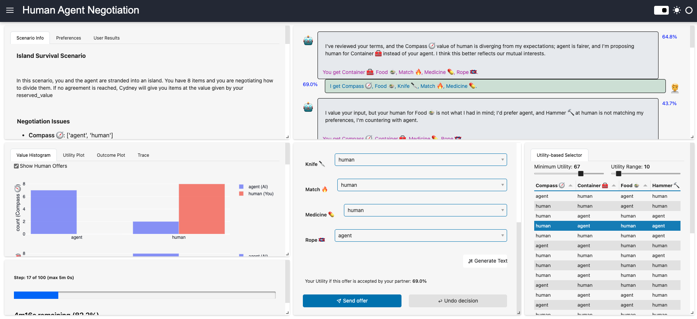

# Human-Agent Negotiation Interface (HANI)

[](https://pypi.python.org/pypi/hani)
[](https://pypi.python.org/pypi/hani)
[](https://pypi.python.org/pypi/hani)
[](https://pypi.python.org/pypi/hani)
[](https://autoneg.github.io/hani/)



>  **Status: superseded by HANI2.** This project (HANI) is no longer used as the official interface for the ANAC Human-Agent Negotiation (HAN) and Hybrid Intelligence (HI) leagues. Future development happens in **[HANI2](https://github.com/autoneg/hani2)** ([documentation](https://autoneg.github.io/hani2/), `pip install hani2`). HANI stays available for existing users but will receive no new features.

HANI is a web-based interface for conducting negotiations between humans and AI agents. It provides a rich set of tools for analyzing negotiation dynamics, making offers, and understanding your negotiation partner's behavior — plus an optional LLM **negotiation support agent**, an **autopilot**, and a complete **experiment / Prolific workflow** for running human-subject studies.

## Three Goals

HANI is a research platform for building and evaluating the three pieces of a
human-agent negotiation, each of which can be developed independently.

### 1. Opponent agents — agents that negotiate *against* a human

Drop in any negotiator and have real people play against it across a variety of
scenarios, then measure how it did.

```bash
# a time-based baseline, a Genius agent, and your own class, as the opponent pool
hani --agents "BoulwareTBNegotiator,helpers.AgentK,file:agents/myneg.MyNegotiator"
```

See [Agents & Opponent Pools](docs/agents.md).

### 2. Support tools — passive aids the human consults while negotiating

Panels the negotiator can open, reorder, or ignore. They inform; they never act.
HANI ships a set (preference viewer, 2-D utility plot, offer histograms, exchange
history, outcome space plot, response generator) and adding one means subclassing
`Tool`.

```python
# src/hani/tools/mytool.py
class MyTool(Tool):
    def panel(self): ...       # what the human sees
```

See [Tools](docs/tools.md) and [Offer Generators](docs/offer-generators.md).

### 3. Support agents — an agent that *teams with* the human against the opponent

An LLM agent sitting beside the human: it can advise, fill in a counter-offer for
approval, or — at the autonomy it is granted — act on the human's behalf. Every
action is gated by a capability lattice (`chat`, `toast`, `fill_offer`,
`submit_counter`, `accept`, `end`, tool show/hide/reorder, …) crossed with an
autonomy level (`suggest` / `semi` / `full`). The effective permission is the
intersection of the admin's ceiling and the user's own setting, so the human
decides how much of the negotiation to hand over.

```bash
hani --support-agent auto     # 'on' (everyone) | 'off' | 'auto' (admins only)
```

See [Support Agent & Autopilot](docs/support-agent.md).

📖 **Full documentation:** [autoneg.github.io/hani](https://autoneg.github.io/hani/) — installation, quick start, authentication, tools, [support agent & autopilot](https://autoneg.github.io/hani/support-agent/), [agent pools](https://autoneg.github.io/hani/agents/), [scenarios](https://autoneg.github.io/hani/scenarios/), [experiments](https://autoneg.github.io/hani/experiments/) and [Prolific integration](https://autoneg.github.io/hani/prolific/).

🎮 **Try it now:** [anac.cs.brown.edu/hanplay/app](https://anac.cs.brown.edu/hanplay/app) — public playground, no signup required.

## Quick Start

### Installation

```bash
pip install hani
```

### Initial Setup

Run the setup command to initialize your configuration:

```bash
hani setup
```

This creates the settings directory at `~/negmas/hani/settings/` with:
- `env.json` - Main configuration file
- `users.json` - User credentials
- `scenarios/` - Default negotiation scenarios
- Other configuration files

### Running the App

```bash
hani
```

This starts both the main app (port 5006) and guest/playground (port 5008).

Then open your browser to `http://localhost:5006` and log in:
- **Username:** `admin` or `user`
- **Password:** `adminpass` or `userpass` (defaults, change in env.json)

## CLI Commands

| Command | Description |
|---------|-------------|
| `hani` | Start all services (main app + guest playground) |
| `hani setup` | Initialize settings directory with default configuration |
| `hani main` | Start only the main app (default port 5006) |
| `hani guest` | Start only the guest/playground app (default port 5008) |
| `hani auth` | Show OAuth setup instructions |
| `hani experiment create <name>` | Scaffold a named experiment under `~/hani/experiments/<name>/` |
| `hani --help` | Show all available commands and options |

Additional executables installed alongside `hani`:

| Executable | Description |
|------------|-------------|
| `hani-app` | The authenticated app directly (all `panel serve` flags forwarded) |
| `hani-guest` | The guest / playground app (`HANI_GUEST_MODE=true`); the Prolific entry point |
| `hani-reg` | The standalone registration server |
| `hani-analysis` | Launch the event analytics dashboard |
| `hani-experiment` | Manage experiment labels in the event-tracking database |

Each command accepts a `--port` flag (e.g. `hani guest --port 12000`,
`hani-app --port 6006`, `hani-reg --port 5107`). The top-level `hani`
command takes `--main-port` / `--guest-port` to override both services
at once. Equivalent env vars: `HANI_PORT`, `HANI_GUEST_PORT`,
`HANI_REG_PORT`.

Key flags:

| Flag | Available on | Purpose |
|------|--------------|---------|
| `--agents` | `hani`, `hani main`, `hani guest`, `hani-app`, `hani-guest` | Opponent pool (specs and/or `:group` tokens) |
| `--support-agent on\|off\|auto` | `hani`, `hani-app`, `hani-guest` | Who gets the Negotiation Support Agent (env: `HANI_SUPPORT_AGENT`) |
| `--experiment <name>` | `hani-app`, `hani-guest` | Run a named experiment (env: `HANI_EXPERIMENT`, honoured by every entry point) |
| `--no-main` / `--no-guest` | `hani` | Start only some services |
| `--no-browser` | `hani`, `hani main`, `hani guest` | Don't auto-open a browser |
| `--verbose` | all app entry points | Verbose negotiator output |
| `--dev` | `hani-app` | Development mode with auto-reload (`hani-guest` forwards unknown flags straight to `panel serve`) |

For paid Prolific studies, see [docs/prolific.md](docs/prolific.md); for named
experiments, [docs/experiments.md](docs/experiments.md).

### Command Options

```bash
# Start with specific agent types
hani --agents "AspirationNegotiator,helpers.AgentK"

# Start with a whole family of negotiators
hani --agents ":template,:notext"

# Force the Negotiation Support Agent off for this deployment
hani --support-agent off

# Run a named experiment (its own consent, scenarios, questionnaires, results)
HANI_EXPERIMENT=my-study hani
hani-guest --experiment my-study --port 5008

# Start without opening browser
hani main --no-browser

# Run setup and overwrite existing files
hani setup --force

# Set custom admin password during setup
hani setup --admin-password "my-secure-password"
```

## Configuration

HANI uses a JSON configuration file located at `~/negmas/hani/settings/env.json`.

### Basic Configuration

```json
{
    "urls": {
        "app": "http://localhost:5006",
        "playground": "http://localhost:5008"
    },
    "admin": {
        "password": "adminpass",
        "emails": []
    },
    "auth": {
        "mode": "password",
        "cookie_secret": "change-this-in-production"
    }
}
```

### Configuration Options

| Setting | Description | Default |
|---------|-------------|---------|
| `urls.app` | Main app URL | `http://localhost:5006` |
| `urls.playground` | Guest playground URL | `http://localhost:5008` |
| `admin.password` | Admin user password | `adminpass` |
| `admin.emails` | Admin emails for OAuth mode | `[]` |
| `auth.mode` | Auth mode: `password`, `dual`, `oauth`, `auto` | `password` |
| `auth.cookie_secret` | Session cookie secret | (default value) |
| `auth.enforce_consent` | Require consent form before negotiation | `false` |

## Features

### Negotiation Interface

- **Action Panel**: Make offers by setting values for each negotiation issue, in a
  1- or 2-column layout (`n_issue_columns` per domain)
- **Accept / Reject / End** decision row, with the counter-offer UI revealed on
  Reject (or always, via the "Offer Panel Always Visible" toggle)
- **History View**: The full negotiation history from both parties, with a
  "Partner is thinking…" typing indicator while the agent computes its response
- **Utility Display**: Real-time feedback on how good each offer is for you, and a
  red confirmation dialog when you are about to accept below your reserved value
- **Text Messages**: Optionally attach a natural-language message to any offer
- **Countdown Timer**: Per-round time limit with timeout handling
- **Outcome Toasts**: Every round ends with what actually happened — "timed out",
  "was ended by you", "was ended by the AI agent", or "reached an agreement"

### Negotiation Support Agent

An optional LLM assistant that sits with the human negotiator, in a floating chat
bubble at the bottom-right of the page. **On by default** (off by default in
Prolific sessions), always user-toggleable. It can:

- **Chat** with the participant, and post proactive, unprompted observations
- **Send toast notifications** or write to an always-visible status board — the
  participant chooses where proactive messages land
- **Control the tool panel**: enable/disable, show/hide and reorder any tool
- **Drive the action panel**: fill the offer, write the message, and — subject to
  its granted autonomy — send a counter-offer, accept, or end

Permissions follow a **capability lattice**: an admin grants a ceiling
(`suggest` / `semi` / `full` autonomy plus per-capability switches) and the human
negotiator can only *narrow* it, never widen it. Every agent-initiated action is
logged distinctly (`component="SupportAgent"`, `actor="agent"`), so analysis can
separate it from the human's own clicks.

It is a multi-turn **tool-calling** agent built on `litellm`, so it runs against
any provider (OpenAI, Anthropic, Ollama, Azure, Gemini, …) with its own key, host
and model in `support_agent_settings.json` — independent of the single-shot LLM
used by the offer generators. You can replace it wholesale by subclassing
`SupportAgent` (and optionally `ToolDispatcher`) and pointing `agent_class` at
your class; a bad override falls back to the built-in agent rather than taking the
feature down.

→ [docs/support-agent.md](docs/support-agent.md)

### Autopilot

**Autopilot** hands *all* of the human's decisions to a driver — no human input at
all. It is configured separately (`autopilot_settings.json`) so it works even with
the Support Agent disabled, and is engaged from a top-bar switch.

- **Driver = Support Agent**: the LLM assistant decides every turn (temporarily
  forced to FULL autonomy, restored on disengage)
- **Driver = any negmas / negmas-llm negotiator**: it plays the human's seat
  directly, instantiated with the human's utility function
- **Admin gate**: the switch is live only when the admin allows it, a driver
  resolves, and (for the Support-Agent driver) the agent is enabled this session
- **Stall net**: a turn that fails to act sends a counter to keep the negotiation
  moving and, after repeated failures, auto-disengages and hands control back

→ [docs/support-agent.md#autopilot](docs/support-agent.md#autopilot)

### AI-Powered Tools

When configured with an LLM API key, HANI provides:

- **Text-to-Outcome Extraction**: Extract structured offers from natural language messages
- **Outcome-to-Text Generation**: Generate natural language descriptions of your offers
- **Response Generator**: Describe what you want to say and let AI generate both the message and offer
- **Utility-based Selector** and **Random Outcome Selector** for constructing offers

### Analysis Tools

- **Utility Plot**: Visualize utility over time
- **Outcome Plot**: See where offers fall in the outcome space
- **Preferences View**: Understand your preferences for the negotiation
- **Negotiation Trace**: Detailed log of all negotiation events
- Tools can be shown/hidden, reordered and moved between panes — by the
  participant, or by the Support Agent

### Agents & Opponent Pools

- Group tokens for whole families of negotiators: `:llm`, `:template`, `:negmas`,
  `:hani`, `:genius`, `:notext`, `:custom`, `:pan`
- **Per-session pools** via `?agents=…` / `?group=…` query args, so a launcher can
  hand different participants different opponent pools without a restart
- **Participant group files**: an external tool may drop
  `<results>/groups/<key>.json` (a bare list, or `{"syspath": …, "agents": …}` so
  unzipped competitor packages import) — HANI only ever reads it and stays standalone
- **Admin mode** (`?admin=1` or a real admin): ADMIN badge, an opponent
  name/class pill in the top bar, and an opponent picker that overrides the
  per-round random pick and survives reloads
- **Robustness**: agent LLM failures are survived rather than fatal, Ollama calls
  fall back to the local daemon when the default endpoint lacks the model, and the
  agent is forbidden from ending practice rounds

→ [docs/agents.md](docs/agents.md)

### Experiments — running human-subject studies

A named **experiment** is a self-contained study bundle under
`~/hani/experiments/<name>/`: its own consent text, scenario order, scenarios,
questionnaires and results root. Nothing changes until you opt in — with no
experiment selected every path is exactly what it always was.

```bash
hani experiment create my-study          # scaffold from the current defaults
HANI_EXPERIMENT=my-study hani            # run that experiment
hani-guest --experiment my-study         # …or a single service
```

Resolution order for every experiment artefact is
`experiment dir` → `~/negmas/hani/settings/` → package defaults.

→ [docs/experiments.md](docs/experiments.md)

### Prolific workflow

End-to-end support for paid studies on [Prolific](https://www.prolific.com). Point
the study link at the **guest** app with the PID
(`https://your-host/hanplay?PROLIFIC_PID={}`) and HANI switches into
Prolific mode:

- **PID-derived identity** and per-PID state under
  `<results>/prolific_<PID>/` (`prolific_session.json`, `schedule.json`,
  `results.csv`, `last_scenario.txt`)
- **Practice round** followed by `PROLIFIC_N_REQUIRED` **counted** rounds;
  returning participants skip the practice
- **Zero-action rounds don't count** — a participant who lets the clock run out
  without acting sees the same opponent again
- **Per-participant schedule** (`schedule.json`, written by your external service)
  pinning the (partner, scenario) cell of each counted slot; deterministic per-PID
  domain pinning when no schedule exists, and a deterministic finalist rotation
  rather than a random fallback
- **Per-negotiation questionnaires** from YAML (`likert5`/`likert7`/`yes_no`/
  `select`/`text`) rendered between counted rounds
- **Auto-start** after `PROLIFIC_AUTO_START_SECONDS` so a session can't stall,
  and a **completion link** to
  `{SCMLWEB_BASE_URL}/prolific/done?PROLIFIC_PID=<pid>`
- **Participant-safe UI**: admin-only cards are hidden (not merely disabled), the
  sidebar locks at the first counted round, partner agent types are never shown,
  and the Support Agent switch starts off
- Env knobs: `PROLIFIC_N_REQUIRED`, `PROLIFIC_MAX_MINUTES`,
  `PROLIFIC_AUTO_START_SECONDS`, `PROLIFIC_FINALISTS`, `PROLIFIC_PER_NEG_YAML`,
  `SCMLWEB_BASE_URL`

→ [docs/prolific.md](docs/prolific.md)

### Data collection & analytics

- **`results.csv`** — one row per negotiation: utilities, agreement, `status`,
  `ended_by`, `practice`, `human_advantage`, timing
- **Negotiation trace** — every event of every round
- **Per-negotiation LLM logs** — set `HANI_LLM_LOG=1` and every
  `litellm.completion` the opponent makes (prompt, full response, hidden
  reasoning, model, latency, tokens) is appended to one JSONL file per
  negotiation, so a degenerate agent turn can be diagnosed afterwards
- **Support Agent attribution** — agent-initiated actions logged separately from
  human clicks
- **Event analytics dashboard** — `hani-analysis` launches a Panel dashboard over
  the collected event data; `hani-experiment` labels windows of that event data

→ [docs/experiments.md](docs/experiments.md#data-collected-per-negotiation)

## Authentication

HANI supports multiple authentication modes configured via `auth.mode` in `env.json`.

### Password Authentication (Default)

Best for local development and small deployments.

```json
{
    "auth": {
        "mode": "password"
    }
}
```

- Users stored in `~/negmas/hani/settings/users.json`
- Default users: `admin`/`adminpass` and `user`/`userpass`
- New users can register via `/register` endpoint

### Dual Authentication (Password + OAuth)

Allows users to log in with either password or OAuth providers.

```json
{
    "auth": {
        "mode": "dual"
    },
    "oauth": {
        "redirect_uri": "http://localhost:5006",
        "providers": {
            "github": {
                "enabled": true,
                "key": "your-github-client-id",
                "secret": "your-github-client-secret"
            },
            "google": {
                "enabled": true,
                "key": "your-google-client-id",
                "secret": "your-google-client-secret"
            }
        }
    }
}
```

### Setting Up OAuth

Run `hani auth` to see detailed setup instructions. Here's a summary:

#### GitHub OAuth

1. Go to https://github.com/settings/developers
2. Create a new OAuth App
3. Set Homepage URL: `http://localhost:5006`
4. Set Authorization callback URL: `http://localhost:5006/oauth/callback`
5. Copy Client ID and Client Secret to `env.json`

#### Google OAuth

1. Go to https://console.cloud.google.com/apis/credentials
2. Create OAuth 2.0 Client ID (Web application)
3. Add authorized redirect URI: `http://localhost:5006/oauth/callback`
4. Copy Client ID and Client Secret to `env.json`

### OAuth Admin Access

In OAuth/dual mode, admin access is granted to users whose email is in the `admin.emails` list:

```json
{
    "admin": {
        "emails": ["admin@example.com", "another-admin@example.com"]
    }
}
```

### Auto Mode

When `auth.mode` is `auto`:
- Uses OAuth if OAuth credentials are configured
- Falls back to password authentication otherwise

## Configuring Agent/Negotiator Types

HANI allows you to specify which negotiator types the AI opponent can use.

### Command-Line Argument (Recommended)

```bash
# Use specific NegMAS negotiators
hani --agents "AspirationNegotiator,BoulwareTBNegotiator,ConcederTBNegotiator"

# Mix of different negotiator types
hani --agents "AspirationNegotiator,helpers.AgentK,helpers.Atlas3,LLMHybridNegotiator"

# Use only HANI custom negotiators
hani --agents "helpers.AgentK,helpers.HardHeaded,helpers.AverageTitForTat"
```

### Agent Groups

Use group syntax to select categories of agents:

```bash
# All LLM-based negotiators
hani --agents ":llm"

# All template-based negotiators
hani --agents ":template"

# All NegMAS negotiators
hani --agents ":negmas"

# Combine groups
hani --agents ":llm,:template"
```

| Token | Pool |
|-------|------|
| `:llm` | All LLM-based negotiators |
| `:template` | All template-based negotiators |
| `:negmas` | All NegMAS negotiators |
| `:hani` | HANI's own negotiators |
| `:genius` | Genius negotiators |
| `:notext` | Boulware / Conceder / Linear / Hybrid with **no** text component |
| `:custom` | The specs listed in `HANI_CUSTOM_AGENTS` |
| `:pan` | The PAN pool (personality-adjusted negotiators), when `pan.py` is importable |

Group tokens expand and de-duplicate while preserving order, so
`:template,:notext` is a valid union.

### Per-Session Opponent Pools

The pool can also be set **per browser session** with query arguments, so a
launcher can give different participants different opponents without restarting:

```
https://your-host/app?agents=BoulwareTBNegotiator,ConcederTBNegotiator
https://your-host/app?group=:notext
https://your-host/app?group=official
```

`?group=<key>` also accepts the key of a **participant group file** that an
external tool may drop at `<results>/groups/<key>.json`:

```json
{
  "syspath": ["/abs/path/to/unzipped/agent/packages"],
  "agents": ["compA.agent.CompetitorA", "compB.agent.CompetitorB"]
}
```

HANI only ever reads that file (a bare JSON list works too); it never calls
another service. The `syspath` entries are added to `sys.path` so dotted specs
for unzipped competitor submissions import cleanly.

### Admin Mode

Open any page with `?admin=1` (or log in as an admin) to get an **ADMIN** badge, a
top-bar pill showing the current opponent's agent name and class, and an
**opponent picker** above Load that overrides the per-round random pick. The
choice persists across the reload that Load triggers; leave it on *auto* to
randomize. Non-admins never see partner agent types.

See [docs/agents.md](docs/agents.md) for the full reference.

### Supported Negotiator Namespaces

#### NegMAS Negotiators (default namespace)
```bash
hani --agents "AspirationNegotiator,BoulwareTBNegotiator,NaiveTitForTatNegotiator"
```

#### HANI Helper Negotiators
```bash
hani --agents "helpers.AgentK,helpers.Atlas3,helpers.CUHKAgent,helpers.HardHeaded"
```

#### Genius Negotiators
```bash
hani --agents "genius.Atlas3,genius.AgentK,genius.HardHeaded"
```

#### LLM-based Negotiators
```bash
hani --agents "LLMHybridNegotiator,LLMBoulwareTBNegotiator,LLMConcederTBNegotiator"
```

#### Custom Negotiators from Files
```bash
# Load from a Python file
hani --agents "file:mynegotiator.MyNegotiator"

# With path
hani --agents "file:agents/custom/myneg.MyNegotiator"
```

## Support Agent Configuration

An optional LLM assistant for the human negotiator, shown as a chat bubble at the
bottom-right of the page. **On by default** for everyone (in Prolific sessions the
user-facing switch starts off); the participant can always turn it off.

### Enabling / disabling

Resolved highest-precedence-first:

1. `--support-agent on|off|auto` on `hani`, `hani-app`, `hani-guest`
2. `HANI_SUPPORT_AGENT=on|off|auto`
3. `mode` in `~/negmas/hani/settings/support_agent_settings.json`

`on` = everyone, `off` = nobody, `auto` = admins only.

```bash
hani --support-agent on             # everyone
hani-app --support-agent off        # force off for this deployment
HANI_SUPPORT_AGENT=auto hani main   # admins only (sub-commands take the env var)
```

### What it can do

| Capability | Effect |
|------------|--------|
| `chat` | Converse in the chat panel, and post unprompted observations |
| `toast` | Send toast notifications |
| `tool_enable` / `tool_visibility` / `tool_order` | Enable/disable, show/hide and reorder any analysis tool |
| `fill_offer` / `fill_text` | Fill the offer widgets and the message to the partner |
| `submit_counter` / `accept` / `end` | Send a counter-offer, accept, or end — gated by autonomy |

Participants also choose whether **proactive** messages arrive as toasts or on the
always-visible bottom status board; chat replies always stay in chat.

### Autonomy

| Level | Counter-offer | Accept / End |
|-------|---------------|--------------|
| `suggest` | Fills the offer + message and highlights Send; the human presses it | Highlights the button only |
| `semi` | Auto-submits | Pops the normal confirmation dialog |
| `full` | Auto-submits | Executes immediately |

The admin sets a **ceiling** (`autonomy` + per-capability switches, editable live
from the "Support Agent (Admin)" sidebar card); the human negotiator can only
narrow it from the "⚙️ Capabilities" panel inside the chat. The effective
permission is the intersection — a participant can never widen what the admin
allowed. Agent-initiated actions are logged as `component="SupportAgent"` with
`actor="agent"`.

### Support Agent Settings File

`~/negmas/hani/settings/support_agent_settings.json` — its own LLM config
(provider, model, key env var, api base, temperature, max tokens, tool-iteration
bound), the capability/autonomy ceiling, proactive event flags, and the system
prompt. Any `litellm` provider works, including a local Ollama.

You can replace the agent entirely by subclassing `SupportAgent` (and optionally
`ToolDispatcher`) and setting `agent_class` to your dotted path; if it can't be
loaded, HANI warns and falls back to the built-in agent.

Full reference — every setting, tool, override hook and the shared action API:
[docs/support-agent.md](docs/support-agent.md).

## Autopilot Configuration

Autopilot lets a driver make **all** of the human's decisions. It has its own
settings file (`autopilot_settings.json`) so it works even when the Support Agent
is off, and is engaged from a top-bar switch; while on, the action panel is hidden
and the history keeps updating.

| Setting | Meaning |
|---------|---------|
| `allowed` | Admin master switch — the Autopilot switch is greyed for everyone when `false` |
| `driver` | The admin-fixed driver: `"Support Agent"` or a negotiator name |
| `allowed_drivers` | Subset offered in the user-facing selector (`null` = all) |
| `step_delay` | Seconds between autopilot steps (`0` = as fast as possible) |

The driver is admin-fixed for authenticated / Prolific sessions and
user-selectable for admins and in the guest playground. With the Support-Agent
driver, a **stall net** sends a counter if the agent fails to act and
auto-disengages after repeated failures so the human regains control.

→ [docs/support-agent.md#autopilot](docs/support-agent.md#autopilot)

## Running Studies

### Named Experiments

An experiment is a self-contained study bundle under `~/hani/experiments/<name>/`:

```bash
hani experiment create my-study     # scaffold from your current defaults
```

```
~/hani/experiments/my-study/
├── consent.md
├── scenario_order.txt
├── scenarios/
├── questionnaires/per_negotiation.yaml
└── results/
```

Select it at startup (server-wide):

```bash
HANI_EXPERIMENT=my-study hani
hani-app   --experiment my-study
hani-guest --experiment my-study
```

Each artefact resolves `experiment dir` → `~/negmas/hani/settings/` → package
defaults, and results are written under the experiment's own `results/`. With no
experiment selected, every path is exactly what it always was — the feature is
purely opt-in. Auth, LLM, Support Agent and Autopilot settings stay global.

→ [docs/experiments.md](docs/experiments.md)

### Prolific Studies

Point the Prolific study link at the **guest** app with the PID:

```
https://your-host.example/hanplay?PROLIFIC_PID={}
```

```bash
HANI_EXPERIMENT=my-study \
PROLIFIC_N_REQUIRED=5 \
PROLIFIC_AUTO_START_SECONDS=120 \
SCMLWEB_BASE_URL=https://anac.cs.brown.edu \
hani-guest --port 5008
```

HANI then runs a practice round, `PROLIFIC_N_REQUIRED` counted rounds (following
`schedule.json` when your service provides one, deterministic per-PID pinning
otherwise), a per-negotiation questionnaire between counted rounds, and finally a
completion link back to your study service. Zero-action rounds don't count and
replay the same opponent; the sidebar locks and admin-only cards stay hidden.

| Variable | Default | Purpose |
|----------|---------|---------|
| `PROLIFIC_N_REQUIRED` | `5` | Counted negotiations required (practice is on top) |
| `PROLIFIC_MAX_MINUTES` | `45` | Recommended duration shown to the participant (not enforced) |
| `PROLIFIC_AUTO_START_SECONDS` | `120` | Idle timeout before the next round auto-starts |
| `PROLIFIC_FINALISTS` | *(empty)* | Dotted class names available for counted rounds |
| `PROLIFIC_PER_NEG_YAML` | *(unset)* | Path to the per-negotiation questionnaire YAML |
| `SCMLWEB_BASE_URL` | `https://anac.cs.brown.edu` | Base URL for the completion link |

→ [docs/prolific.md](docs/prolific.md)

### Collecting & Analyzing Data

```bash
HANI_LLM_LOG=1 hani-guest --port 5008   # log every opponent LLM call, per negotiation
hani-analysis                           # event analytics dashboard
hani-experiment list --active-only      # event-tracking experiment labels
```

Per participant you get `results.csv` (utilities, agreement, `status`,
`ended_by`, `practice`, `human_advantage`, timing), questionnaire answers, the
negotiation trace, and — with `HANI_LLM_LOG=1` — one JSONL file per negotiation
holding the opponent's prompts, full responses, hidden reasoning, latency and
token usage.

→ [docs/experiments.md](docs/experiments.md#data-collected-per-negotiation)

## Customization

### Announcements

Create `~/negmas/hani/settings/announcements.md` to display custom announcements on the welcome screen.

### Scenarios

Custom scenarios can be placed in `~/negmas/hani/settings/scenarios/`. Run `hani setup` to copy the default scenarios as examples. When an experiment is active, its own `scenarios/` directory is used instead — see [Named Experiments](#named-experiments) and [docs/scenarios.md](docs/scenarios.md).

### Consent Form

Edit `~/negmas/hani/settings/consent.md` to customize the consent form (or `~/hani/experiments/<name>/consent.md` for a per-experiment one). Enable it with:

```json
{
    "auth": {
        "enforce_consent": true
    }
}
```

## How It Works

1. **Scenario Loading**: A negotiation scenario is loaded with defined issues (e.g., price, quantity) and preferences for each party.

2. **Turn-Based Negotiation**: You and the AI agent take turns making offers. Each offer specifies values for all issues.

3. **Decision Making**: On each turn, you can:
   - **Send an offer**: Propose specific values for each issue
   - **Accept**: Accept the current offer from your partner
   - **End Negotiation**: Terminate without agreement

4. **Text Messages**: Optionally include natural language messages with your offers to communicate intent.

5. **Analysis**: Use the built-in tools to understand the negotiation dynamics and make informed decisions.

6. **Assistance (optional)**: The [Negotiation Support Agent](#support-agent-configuration)
   can advise you, rearrange your tools, and — up to the autonomy you allow —
   fill or even submit your moves. [Autopilot](#autopilot-configuration) hands the
   whole negotiation to a driver.

7. **Study mode (optional)**: In a [named experiment](#named-experiments) or a
   [Prolific session](#prolific-studies), rounds are scheduled, counted and
   recorded, with questionnaires between rounds and a completion link at the end.

## LLM Configuration (Admin)

Administrators can configure LLM settings in the sidebar under "LLM Settings":

- **Provider**: OpenAI or Anthropic
- **Model**: The model to use (e.g., `gpt-4o-mini`, `claude-3-haiku`)
- **Temperature**: Controls response randomness (0.0-2.0)
- **Prompts**: Customize extraction and generation prompts

LLM API keys can be set in `~/negmas/hani/settings/llm_settings.json` or via environment variables (`OPENAI_API_KEY`, `ANTHROPIC_API_KEY`).

## Development

### Contributing

To contribute, clone this repo and install development dependencies:

```bash
git clone https://github.com/autoneg/hani.git
cd hani
pip install -e ".[dev]"
```

### Running in Development Mode

```bash
hani-app --dev --port 5006      # authenticated app, auto-reload
```

`--dev` enables auto-reload when files change. The bundled `run.sh` /
`runguest.sh` wrappers show the flags used for the reverse-proxied deployment.

### Project Structure

```
src/hani/
├── app.py              # Main application
├── auth.py             # Authentication utilities
├── common.py           # Shared configuration + experiment path resolution
├── dual_auth.py        # OAuth and dual auth handlers
├── llm_service.py      # LLM integration (extraction / generation)
├── llm_logging.py      # Per-negotiation LLM call logging (HANI_LLM_LOG)
├── ollama_fallback.py  # Retry ollama calls against the local daemon
├── events.py           # Event tracking
├── event_analytics.py  # Analytics dashboard (hani-analysis)
├── run.py              # CLI entry point (hani, hani experiment …)
├── runapp.py           # hani-app
├── runguest.py         # hani-guest (Prolific entry point)
├── runexperiment.py    # hani-experiment (event-DB experiment labels)
├── runanalytics.py     # hani-analysis
├── support_agent/      # Negotiation Support Agent + Autopilot
│   ├── runtime.py      # The agent: conversation + tool-calling loop
│   ├── capabilities.py # Capability / autonomy lattice (admin ∩ user)
│   ├── tools.py        # Tools exposed to the LLM
│   ├── tool_controller.py  # Show/hide/reorder analysis tools
│   ├── floating_ui.py  # Chat bubble, capability panel, status board
│   ├── autopilot.py    # Autopilot drivers, stall net, autopilot settings
│   ├── admin_ui.py     # Admin sidebar cards
│   └── settings.py     # support_agent_settings.json load/save
├── tools/              # Analysis tools
│   ├── generator.py    # Response generator tool
│   ├── preferences.py  # Preferences viewer
│   └── ...
├── scenarios/          # Built-in negotiation scenarios
├── sample_scenarios/   # Default scenarios copied on setup
└── default_settings/   # Default configuration files
```

## License

This project is licensed under the [GNU Affero General Public License v3.0 (AGPL-3.0)](https://www.gnu.org/licenses/agpl-3.0.en.html).

See the [LICENSE](LICENSE) file for details.

## Author

Yasser Mohammad (yasserfarouk@gmail.com)
