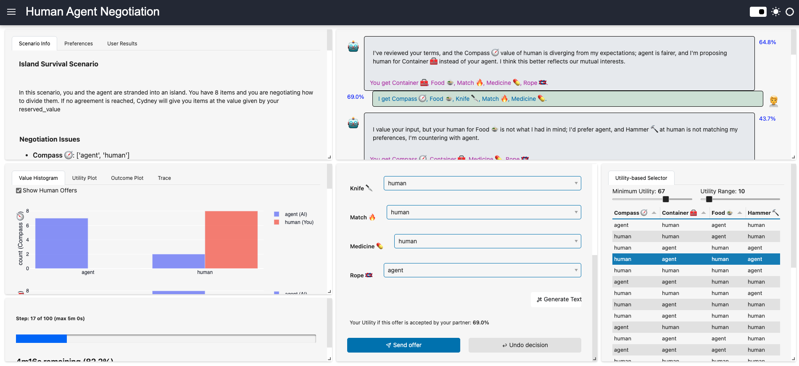

# Human-Agent Negotiation Interface (HANI)



HANI is a web-based interface for conducting negotiations between humans and AI agents. It provides a rich set of tools for analyzing negotiation dynamics, making offers, and understanding your negotiation partner's behavior.

## Key Features

<div class="grid cards" markdown>

-   :material-handshake:{ .lg .middle } __Interactive Negotiation__

    ---

    Turn-based negotiation against AI agents: offer panel, natural-language
    messages, live utility feedback, countdown timer, and reserved-value
    warnings

    [:octicons-arrow-right-24: Quick Start](quickstart.md)

-   :material-robot-happy:{ .lg .middle } __Negotiation Support Agent__

    ---

    An LLM assistant in a chat bubble that advises, sends notifications,
    rearranges your tools, and — within the autonomy you allow — drives the
    offer panel for you

    [:octicons-arrow-right-24: Support Agent](support-agent.md)

-   :material-airplane-takeoff:{ .lg .middle } __Autopilot__

    ---

    Hand the whole negotiation to a driver — the Support Agent or any
    negmas negotiator — with an admin gate and a stall net

    [:octicons-arrow-right-24: Autopilot](support-agent.md#autopilot)

-   :material-chart-line:{ .lg .middle } __Analysis Tools__

    ---

    Utility and outcome plots, preferences view, negotiation trace, and
    LLM-powered offer generators

    [:octicons-arrow-right-24: Tools](tools.md)

-   :material-flask:{ .lg .middle } __Experiments & Prolific__

    ---

    Named, self-contained experiments plus end-to-end Prolific support:
    practice and counted rounds, schedules, questionnaires, per-participant
    results

    [:octicons-arrow-right-24: Experiments](experiments.md)

-   :material-account-group:{ .lg .middle } __Agent Pools__

    ---

    Choose the opponent pool per server, per session (`?agents=` / `?group=`)
    or per round with the admin opponent picker

    [:octicons-arrow-right-24: Agents](agents.md)

-   :material-shield-lock:{ .lg .middle } __Authentication__

    ---

    Password, OAuth (GitHub/Google), dual and auto modes, consent enforcement,
    and an unauthenticated guest playground

    [:octicons-arrow-right-24: Authentication](authentication.md)

-   :material-cog:{ .lg .middle } __Flexible Configuration__

    ---

    JSON configuration, custom scenarios, per-experiment overrides, and any
    LLM provider — including local models via Ollama

    [:octicons-arrow-right-24: Ollama](ollama.md)

</div>

## Quick Start

### 1. Install HANI

```bash
pip install hani
```

### 2. Initialize Configuration

```bash
hani setup
```

### 3. Start the Application

```bash
hani
```

Then open your browser to [http://localhost:5006](http://localhost:5006) and log in with the default credentials:

- **Username:** `admin` or `user`
- **Password:** `adminpass` or `userpass`

## Next Steps

- [Installation Guide](installation.md) - Detailed installation instructions
- [Quick Start Guide](quickstart.md) - Get up and running quickly
- [Authentication](authentication.md) - Configure authentication for your needs
- [Tools](tools.md) and [Offer Generators](offer-generators.md) - The analysis and offer-construction panels
- [Support Agent & Autopilot](support-agent.md) - The LLM assistant, its capability/autonomy model, and how to build your own
- [Agents & Opponent Pools](agents.md) - Pick and group the negotiators your participants face
- [Defining Scenarios](scenarios.md) - Create custom negotiation scenarios
- [Experiments](experiments.md) - Self-contained studies: consent, scenarios, questionnaires, results
- [Prolific Integration](prolific.md) - Run a paid study end to end
- [Setting up Ollama](ollama.md) - Run everything against local models

## License

HANI is released under the GNU Affero General Public License v3 (AGPL-3.0).

## Author

Created by [Yasser Mohammad](mailto:yasserfarouk@gmail.com)
