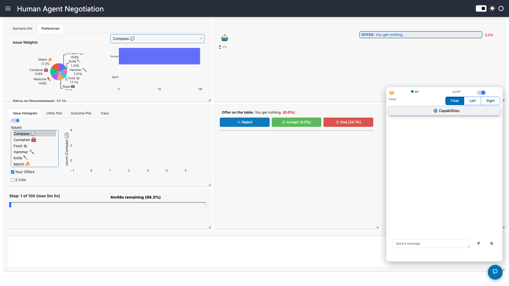
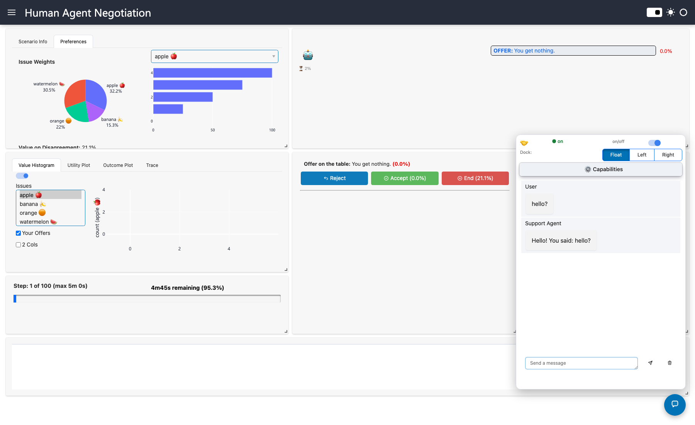
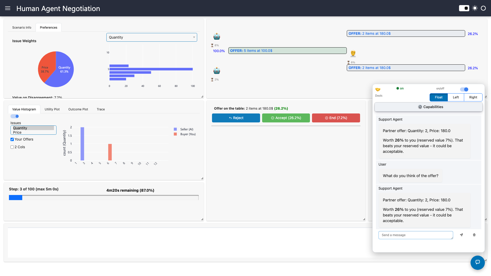
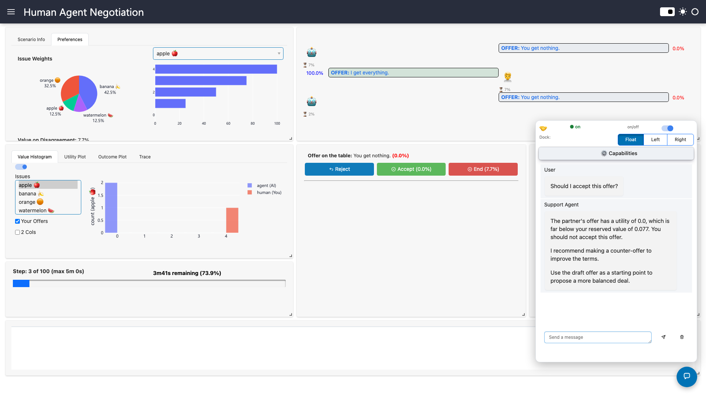
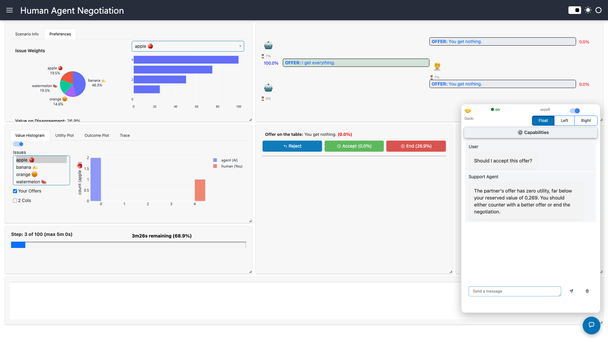
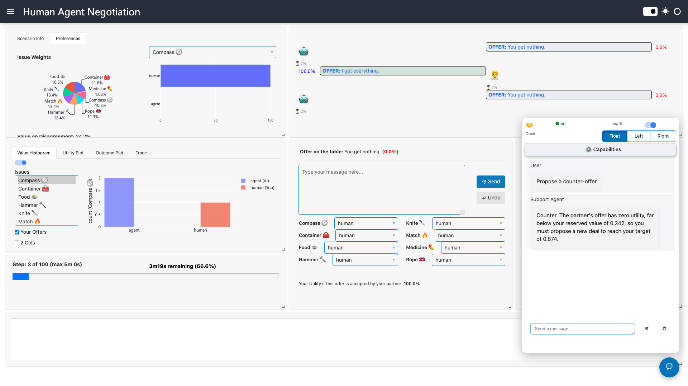

# Tutorial: Build Your Own Negotiation Support Agent

In this tutorial you build a **Negotiation Support Agent** — an assistant that sits
next to a human negotiator in HANI and helps them during a live negotiation — and
grow it step by step, **from a 6-line agent with no AI at all to a useful deal coach**.
Every level is a small, runnable Python file and ends with an experiment in the HANI
interface running on your own machine.

| Level | You build | You learn | Needs an LLM? |
|-------|-----------|-----------|---------------|
| [0](#level-0-install-and-look-around) | — | Install HANI and open the interface | no |
| [1](#level-1-the-simplest-possible-agent) | An agent that echoes your message | The `SupportAgent` class and how HANI loads yours | no |
| [2](#level-2-an-agent-that-reads-the-negotiation) | A rule-based advisor | Reading the live negotiation state | no |
| [3](#level-3-give-it-a-brain) | An LLM coach | System prompts and local models (Ollama) | yes |
| [4](#level-4-give-it-a-tool) | A coach with its own tool | Tool calling | yes |
| [5](#level-5-the-finished-deal-coach) | The finished **Deal Coach** | Proactive advice, safe autonomy | yes |

All the code lives in
[`examples/support_agent_tutorial/`](https://github.com/autoneg/hani/tree/main/examples/support_agent_tutorial).
Levels 0–2 work with no model at all, so you can stop there and still have a working agent.

!!! note "Your screen will look a little different"
    HANI's playground builds a fresh scenario for each session, so the issues, numbers
    and partner offers in your session will differ from the screenshots. The behaviour
    is what matters.

---

## Level 0: Install and look around

**1. Install HANI** (Python 3.13 or newer):

=== "uv"

    ```bash
    uv venv && source .venv/bin/activate
    uv pip install hani
    ```

=== "pip"

    ```bash
    python -m venv .venv && source .venv/bin/activate
    pip install hani
    ```

**2. Create the settings folder:**

```bash
hani setup
```

This creates `~/negmas/hani/settings/`, which is where the agent's settings will live.

**3. Get the tutorial files** (or write them yourself as you go):

```bash
git clone https://github.com/autoneg/hani.git
cd hani/examples/support_agent_tutorial
```

**4. Start the playground** — the *guest* app needs no login:

```bash
PYTHONPATH=$PWD hani guest
```

!!! important "Why `PYTHONPATH`?"
    HANI runs as a separate server process and imports your agent **by name**. The folder
    that holds your agent file must therefore be importable by that process.
    `PYTHONPATH=$PWD` does exactly that. If you forget it, HANI prints
    `could not load custom agent_class …; using default` and silently uses the built-in
    agent — see [Troubleshooting](#troubleshooting).

Open <http://localhost:5008/app>. Click **Start** to begin a negotiation against a
built-in opponent. You will see the offers, the analysis tools, and, at the bottom right,
a round **chat bubble**. That bubble is the Support Agent; click it to open its chat.



Out of the box this is the *built-in* agent, which needs an LLM to answer. Let's replace
it with our own.

---

## Level 1: The simplest possible agent

An agent is a subclass of `SupportAgent`. HANI calls its `handle_user_message` every time
the human types in the chat. `self.post(...)` writes a reply.

```python title="level1_hello.py"
from hani.support_agent.runtime import SupportAgent


class HelloAgent(SupportAgent):
    def handle_user_message(self, text: str) -> None:
        self.post(f"Hello! You said: {text}")
```

That is the whole agent. No model, no network. To tell HANI to use it, edit
`~/negmas/hani/settings/support_agent_settings.json` (create it if it does not exist):

```json
{ "agent_class": "level1_hello:HelloAgent" }
```

The format is `module:Class`. Restart the playground
(`PYTHONPATH=$PWD hani guest`), click **Start**, open the chat bubble and type `hello?`:



!!! success "Experiment"
    Change the reply text, restart, and chat again. Anything you `self.post` appears in
    the chat as the *Support Agent*. You are now running your own agent inside HANI.

---

## Level 2: An agent that reads the negotiation

A useful assistant knows what is happening. HANI exposes the live negotiation through
`session_state["actions"]["context"]()`, which returns the issues, the partner's offer,
**its utility to you**, your reserved value, the draft offer, the time elapsed, and the
history.

The chat handler runs on a **worker thread**, while the interface lives on another. Read
interface state through `self.run_on_doc(...)`, which hops to the right thread for you.

```python title="level2_rules.py"
from hani.support_agent.runtime import SupportAgent


class RulesAgent(SupportAgent):
    def handle_user_message(self, text: str) -> None:
        actions = self.session_state.get("actions")
        if not actions:  # no negotiation has been loaded yet
            self.post("Load a scenario and start a negotiation first.")
            return

        # We are on a worker thread: read UI-owned state via run_on_doc.
        ctx = self.run_on_doc(actions["context"])

        offer = ctx["partner_offer"]
        if offer is None:
            self.post("Your partner has not made an offer yet.")
            return

        utility = ctx["partner_offer_utility"]
        reserved = ctx["reserved_value"]
        if utility < reserved:
            advice = "That is **worse than walking away** - do not accept it."
        else:
            advice = "That beats your reserved value - it could be acceptable."
        offer_text = ", ".join(f"{issue}: {value}" for issue, value in offer.items())
        self.post(
            f"Partner offer: {offer_text}\n\n"
            f"Worth **{utility:.0%}** to you (reserved value {reserved:.0%}). {advice}"
        )
```

Point the settings at it: `{ "agent_class": "level2_rules:RulesAgent" }`, restart, click
**Start**, then **Reject → Send** to make a counter-offer and let the partner answer.
Ask `What do you think of the offer?`:



!!! success "Experiment"
    Make a few different counter-offers. Watch the verdict flip between *worse than
    walking away* and *could be acceptable* as the partner's offer changes.

This agent is **predictable and free**, but it only understands one question. For
open-ended conversation we need a language model.

---

## Level 3: Give it a brain

Now we let an LLM do the talking. HANI already runs the full tool-calling loop; all you
supply is the **persona**, by overriding `build_system_prompt`. The live negotiation
state is attached to every message automatically.

```python title="level3_llm_coach.py"
from hani.support_agent.runtime import SupportAgent

COACH_PROMPT = """You are a calm, concise negotiation coach.
You always receive the live negotiation state with the user's message.
Rules:
- Answer in at most three short sentences.
- Compare the partner's offer with the user's reserved value before advising.
- Never tell the user to accept an offer worth less than their reserved value.
- Never reveal the user's utility numbers to the partner."""


class CoachAgent(SupportAgent):
    def build_system_prompt(self) -> str:
        return COACH_PROMPT
```

### Run a model locally with Ollama

HANI's default support-agent model is a small local one, so nothing leaves your machine:

```bash
ollama pull qwen3:4b-instruct
```

(See [Setting up Ollama](ollama.md) for details, including using a cloud provider
instead.) Then:

```json
{ "agent_class": "level3_llm_coach:CoachAgent" }
```

The `provider` and `model` default to `ollama` / `qwen3:4b-instruct`, so nothing else is
needed. Restart, **Start**, make a counter-offer, and ask `Should I accept this offer?`:



!!! success "Experiment"
    Edit `COACH_PROMPT`: make the coach aggressive, or make it reply in another language.
    Restart and compare. The prompt alone changes the whole personality.

!!! warning "Small models are not perfect"
    A 4B-parameter model can misjudge numbers. That is the motivation for the next level:
    do the arithmetic in **code** and let the model explain it.

---

## Level 4: Give it a tool

A *tool* is a Python function the model may call. We add one that makes the accept /
counter / end decision deterministically — comparing the offer with your reserved value
and with a target that relaxes as the deadline nears — so the model no longer has to do
the maths.

```python title="level4_tools.py"
from hani.support_agent.runtime import SupportAgent
from hani.support_agent.tools import ToolDispatcher, make_function_schema

from level3_llm_coach import COACH_PROMPT


class CoachDispatcher(ToolDispatcher):
    def register_extra_tools(self) -> None:
        self.register(
            "assess_partner_offer",
            self._assess,
            lambda: make_function_schema(
                "assess_partner_offer",
                "Judge the partner's current offer against the user's reserved "
                "value and a target that relaxes as the deadline nears. Call this "
                "before recommending accept / counter / end.",
                {},
                [],
            ),
            capability=None,  # always available (it only reads state)
        )

    def _assess(self, args: dict) -> dict:
        ctx = self.runtime.run_on_doc(self.ss["actions"]["context"])
        utility = ctx["partner_offer_utility"]
        if utility is None:
            return {"ok": False, "error": "the partner has not made an offer yet"}
        reserved = ctx["reserved_value"]
        time = ctx["relative_time"] or 0.0
        target = max(reserved, 0.9 - 0.4 * time)  # 90% at the start, 50% at the end
        if utility < reserved:
            verdict = "end_or_counter"  # worse than walking away
        elif utility >= target:
            verdict = "accept"
        else:
            verdict = "counter"
        return {
            "ok": True,
            "verdict": verdict,
            "offer_utility": round(utility, 3),
            "reserved_value": round(reserved, 3),
            "target_now": round(target, 3),
        }


class ToolCoachAgent(SupportAgent):
    dispatcher_class = CoachDispatcher

    def build_system_prompt(self) -> str:
        return COACH_PROMPT + "\nUse assess_partner_offer to judge any offer."
```

Three pieces: a **schema** that tells the model what the tool is for, a **handler** that
does the work and returns a dict, and `dispatcher_class` to plug it in. Set
`{ "agent_class": "level4_tools:ToolCoachAgent" }`, restart, and ask
`Should I accept this offer?`:



!!! success "Experiment"
    Change the `0.9 - 0.4 * time` target curve to be more stubborn, restart, and see the
    verdict change for the same offer.

---

## Level 5: The finished Deal Coach

Two things turn a chatbot into a *useful* assistant: it speaks up **without being
asked**, and it can **act** — but only as far as you let it.

**Proactive advice.** HANI calls `proactive_note(event)` on lifecycle events. Return a
note to make the agent take a turn; return `None` to stay silent.

```python title="level5_deal_coach.py"
from hani.support_agent.runtime import SupportAgent

from level4_tools import CoachDispatcher
from level3_llm_coach import COACH_PROMPT


class DealCoach(SupportAgent):
    dispatcher_class = CoachDispatcher

    def build_system_prompt(self) -> str:
        return (
            COACH_PROMPT
            + "\nUse assess_partner_offer to judge any offer."
            + "\nWhen you propose a counter-offer, fill it in with set_offer and "
            "set_message_text so the user can review it before sending."
        )

    def proactive_note(self, event_name: str) -> str | None:
        if event_name == "action_requested":
            return (
                "(system) It is the user's turn. Call assess_partner_offer, then "
                "give ONE sentence: accept, counter, or end - and why."
            )
        return None  # stay silent on every other event
```

**Safe autonomy.** The settings decide what the agent is *allowed* to do. For a coach,
let it fill in offers but never send, accept or end on its own:

```json
{
  "agent_class": "level5_deal_coach:DealCoach",
  "autonomy": "suggest",
  "capabilities": { "submit_counter": false, "accept": false, "end": false },
  "proactive": { "on_action_requested": true }
}
```

* `proactive.on_action_requested` makes the agent comment each time it is your turn.
* `autonomy: "suggest"` means that if the agent proposes something, it fills the fields
  and **highlights the button** — you press it.
* Turning off `submit_counter`, `accept` and `end` removes those tools from the model
  entirely.

Restart, click **Start**, make a counter-offer and ask `Propose a counter-offer`. The
coach uses its tool to judge the partner's offer against your reserved value and the
current target, and answers with a concrete recommendation:



!!! note "Proactive notes and small models"
    With `on_action_requested` enabled, the agent also takes a turn by itself each time it
    is your turn. Proactive messages are delivered as a **toast** by default (the
    participant can switch to the status board in the chat panel's settings). They only
    appear if the model produces text, and a 4B local model can stay silent or ignore
    instructions such as "fill in the offer fields". For reliable proactive advice and
    offer filling, point `provider` / `model` at a stronger model.

!!! success "Experiment"
    Open the **⚙️ Capabilities** panel in the chat. You can switch capabilities off, or
    lower the autonomy — a participant can always make the agent *less* powerful, never
    more than the settings allow.

---

## What you built

A support agent that

1. runs inside HANI as an ordinary Python class,
2. understands the live negotiation,
3. converses through an LLM with a persona you control,
4. makes its judgements in tested code via a tool,
5. speaks up when it matters, and
6. can only do what you permitted.

## Troubleshooting

| Symptom | Cause / fix |
|---------|-------------|
| Chat answers like the default agent, and the server log says `could not load custom agent_class` | The agent module is not importable by the server. Start HANI with `PYTHONPATH` pointing to the folder holding your file, and check the `module:Class` spelling. |
| Replies say *Load a scenario…* (Levels 2+) | No negotiation is running. Click **Start** first. |
| `Support agent error` mentioning a connection | Ollama is not running, or the model is not pulled (`ollama pull qwen3:4b-instruct`). |
| The model never calls the tool | Small models can be unreliable at tool calling. Try a stronger one via `"provider"` / `"model"` in the settings file. |
| Changes to your agent are not picked up | Restart `hani guest`; the class is loaded once per server. |

## Where next

* [Agent template](downloads/hani-agent-template.zip) — a download-and-edit starting point.
* [Negotiation Support Agent](support-agent.md) — the full reference: every override,
  capability, autonomy level and the action API.
* [Autopilot](support-agent.md#autopilot) — let an agent make *all* decisions.
* [Setting up Ollama](ollama.md) and [Agents & Opponent Pools](agents.md).
